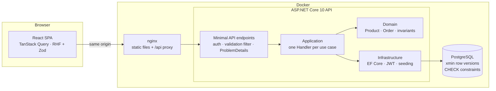

# Development guide

Detailed architecture, setup, testing and deployment notes for StockSync. Run commands from the repository root unless a section says otherwise.

## Architecture



Clean Architecture in a **modular monolith** ([ADR 0001](adr/0001-modular-monolith.md)): stock and orders change in one
transaction. Handlers query EF Core directly instead of hiding it behind repositories ([ADR 0002](adr/0002-handlers-use-ef-core-directly.md)).

```
backend/
  src/StockSync.Domain          entities and business rules; no dependencies
  src/StockSync.Application     use cases (CreateOrder.Handler, ShipOrder.Handler, ...), validators, DTOs
  src/StockSync.Infrastructure  EF Core + PostgreSQL, migrations, JWT, password hashing, demo seed
  src/StockSync.Api             composition root: Configuration/ (auth, rate limiting, proxy, OpenAPI),
                                Http/ (security headers, error mapping, validation), Endpoints/ (one group per feature)
  tests/StockSync.Domain.Tests              fast unit tests of the invariants
  tests/StockSync.Api.IntegrationTests      real HTTP + real PostgreSQL (Testcontainers)
frontend/src/
  features/<feature>/           auth · dashboard · products · orders: page, dialogs, Zod schemas, query hooks (api.ts)
  components/ui/                design-system primitives (Button, Dialog, Field, Table, ...)
  components/                   shared domain widgets (ChannelBadge, StockLevel, SearchInput, ...)
  lib/api/                      fetch client, session refresh, error mapping, API types
  lib/query/ · lib/hooks/ · lib/auth/   query keys and shared queries, URL filters, auth context
docs/adr/                       architecture decision records
```

## Tech stack

| | |
|---|---|
| Backend | .NET 10 (LTS), ASP.NET Core minimal APIs, EF Core 10, Npgsql, FluentValidation, JWT bearer auth, built-in rate limiting, OpenAPI + Scalar |
| Database | PostgreSQL (snake_case schema, UUIDv7 keys, check constraints, optimistic concurrency via `xmin`) |
| Frontend | React 19, TypeScript, Vite, TanStack Query, React Router, React Hook Form + Zod, Tailwind CSS 4, Radix UI, Recharts |
| Testing | xUnit v3 on Microsoft Testing Platform, WebApplicationFactory, Testcontainers, Vitest, Testing Library |
| Quality | Nullable + warnings as errors, analyzers, `dotnet format`, oxlint, Prettier, NuGet lock files, CodeQL, Dependabot |
| Delivery | Docker multi-stage builds (non-root), docker compose, nginx, GitHub Actions |

## Run it

### Hosted portfolio demo

The Render deployment uses `deploy/Dockerfile` to run the React frontend, ASP.NET Core API and a small PostgreSQL
instance together on a single Free web service. Click **Open the demo store** to explore the seeded shop without signing up.

This is a shared, disposable demo. Use sample data only: changes and new accounts are lost when the service restarts,
redeploys or sleeps. Free instances sleep after inactivity, so the first visit can take about a minute to load.
The PostgreSQL socket is private to the container and the API uses a non-superuser database role.

Render settings are tracked in `render.yaml`: Docker, `main`, `deploy/Dockerfile`, Frankfurt, Free and `/health`.
For a production deployment, use the separate services below with a persistent managed database instead.

### Local development

**Everything in Docker** (only Docker needed):

```bash
docker compose up --build
# open http://localhost:8080 and click "Open the demo store"
```

The compose file is a local demo: its defaults are fine on your machine but not on a server. To change them, copy
`.env.example` to `.env` (it is git-ignored) and fill in what you need:

| Variable | Default | |
|---|---|---|
| `POSTGRES_PASSWORD` | `postgres` | password of the `postgres` superuser, used only to initialise the database |
| `APP_DB_PASSWORD` | `stocksync` | password of `stocksync`, the non-superuser role the API connects with. It owns the schema so it can run migrations |
| `JWT_SIGNING_KEY` | random per start | at least 32 characters, e.g. `openssl rand -base64 48`. Without it, sessions end when the API restarts |
| `SEED_DEMO_DATA` | `true` | creates the public demo account. Set to `false` for anything real |

The database roles are created the first time the `pgdata` volume is initialised (`deploy/postgres/01-app-role.sql`).
After changing a password, run `docker compose down -v` to start from a fresh volume.

**Local development** (.NET 10 SDK, Node 24):

```bash
# 1. PostgreSQL on localhost:5432 (database stocksync, app user stocksync / stocksync)
docker compose up -d db

# 2. API on http://localhost:5080. In Development it applies migrations, seeds the demo store
#    and serves the API reference at http://localhost:5080/docs
cd backend
dotnet tool restore
dotnet run --project src/StockSync.Api --urls http://localhost:5080

# 3. Web app on http://localhost:5173 (proxies /api to the API)
cd frontend && npm install && npm run dev
```

Using your own PostgreSQL? Set `ConnectionStrings__Default` before step 2.

### Configuration

| Key | Default | |
|---|---|---|
| `ConnectionStrings:Default` | none (Development: local `stocksync` database) | PostgreSQL connection string |
| `Jwt:SigningKey` | random per process | HMAC key, 32+ characters. Required when running more than one API instance |
| `Jwt:AccessTokenMinutes` · `RefreshTokenDays` · `SessionLifetimeDays` | `15` · `7` · `30` | access token, refresh token, and the absolute limit of a session no matter how often it is refreshed |
| `Database:MigrateOnStartup` · `Database:SeedDemoData` | `false` · `false` | both `true` in Development and in docker compose |
| `RateLimiting:AuthPermitLimit` · `SessionPermitLimit` · `ApiPermitLimit` · `WindowSeconds` | `10` · `60` · `300` · `60` | per IP for register/login, per IP for refresh/logout, per user (or IP) for the rest |
| `LoginThrottling:MaxFailuresPerAccount` · `WindowMinutes` | `10` · `15` | failed sign-ins per account before that account is paused, whatever IPs they come from |
| `ReverseProxy:Enabled` · `KnownNetworks` | `false` · loopback | trust `X-Forwarded-For`/`-Proto` from one proxy hop inside these CIDR ranges. Enable only behind a proxy you control |

Nothing secret is committed: there is no signing key or production connection string in the repository.

## Tests

```bash
cd backend && dotnet test        # domain unit tests + API integration tests (starts PostgreSQL via Testcontainers)
cd frontend && npm test          # schemas, API client, components
```

No Docker? Point the integration tests at any PostgreSQL server and they create and drop their own database:
`STOCKSYNC_TEST_DB="Host=localhost;Username=postgres;Password=postgres" dotnet test`.

Coverage and TRX reports (what CI uploads):
`dotnet test --report-trx --coverage --coverage-output-format cobertura --results-directory TestResults`.

Highlights of the integration suite:
- `Concurrent_orders_for_the_last_units_never_oversell`: 12 parallel orders for 3 units.
- `Sellers_cannot_read_each_others_products` and four more: tenant isolation for reads, writes, orders and shipping.
- `Reusing_an_old_token_after_the_grace_period_revokes_every_session`: refresh token theft detection.
- `Parallel_refreshes_with_one_token_never_fork_the_session`: only one of several simultaneous refreshes wins.
- `Failed_sign_ins_lock_only_the_targeted_account`, `Repeated_sign_in_attempts_are_throttled_without_blocking_session_refresh`: brute-force limits.
- `Unsigned_alg_none_token_is_rejected`, `Token_with_tampered_tenant_claim_is_rejected`: JWT validation.

Code checks that CI runs as well: `dotnet format --verify-no-changes`, `npm run lint`, `npm run format:check`, `npm run typecheck`.

CodeQL runs automatically when the repository is public. The workflow skips private repositories, where code scanning
requires a GitHub Code Security entitlement. The regular build, test and dependency-audit checks run for both visibilities.

## API

| Method | Path | |
|---|---|---|
| POST | `/api/auth/register` · `/login` · `/refresh` · `/logout` | sessions (refresh token in an HttpOnly cookie) |
| GET | `/api/auth/me` | current user |
| GET / POST | `/api/products` | search, filter (`lowStockOnly`), sort, paginate · create |
| GET / PUT | `/api/products/{id}` | details · edit |
| POST | `/api/products/{id}/stock-adjustments` | add or remove units, with a reason |
| GET | `/api/products/{id}/movements` | stock ledger |
| GET / POST | `/api/orders` | filter by status/channel, search · create (reserves stock) |
| POST | `/api/orders/{id}/ship` · `/cancel` | commit or release the reservation |
| GET | `/api/channels` · `/api/dashboard` | |

Errors are [RFC 9457 problem details](https://www.rfc-editor.org/rfc/rfc9457) with a stable `code` (e.g. `Product.InsufficientStock`).

## Security

| Area | Protection |
|---|---|
| Sessions | Access tokens live only in memory. Refresh tokens are `HttpOnly; Secure; SameSite=Strict; Path=/api/auth` cookies, stored as SHA-256 hashes, rotated on every use, and capped at 30 days per sign-in. Reusing a rotated token after a 30-second grace window revokes every session of that user; inside the window (two tabs refreshing together) the loser keeps the new cookie and retries. A row version stops parallel refreshes from forking a session. The SPA drops its cached data whenever the signed-in user changes |
| Tokens | HS256 pinned (`alg: none` and other algorithms are rejected), issuer, audience, lifetime and signature validated, 30-second clock skew. Claims: user id, tenant id, role, token id. No email or name |
| Passwords | PBKDF2 (HMAC-SHA512, 210,000 iterations), older hashes upgraded on sign-in. On sign-in, unknown emails still pay for a hash comparison so timing doesn't reveal accounts. 8 to 128 characters with a letter and a digit |
| Access | Every endpoint requires a signed-in user unless it explicitly opts out (register, login, refresh, logout, health). JWT failures don't explain why a token was rejected |
| Tenancy | EF Core global query filters on every tenant-owned table. The tenant id comes only from the validated token |
| Input | FluentValidation on every command and query (paging, search length, SKU and order number patterns, price and quantity limits). Domain invariants and database `CHECK` constraints back them up. EF Core parameterises every query |
| Abuse | Rate limits per client IP on sign-in, separately on session refresh, and per user on the API. Failed sign-ins are also limited per account. nginx resolves the real client IP from trusted private proxies only, so one noisy client can't use up everyone's limit. 1 MB request body limit in Kestrel and nginx |
| Errors | RFC 9457 problem details. Unexpected exceptions return a generic 500; details stay in the server log. Malformed bodies (including `null` where a value is required) are rejected with 400 |
| Headers | API: `nosniff`, `X-Frame-Options: DENY`, `Referrer-Policy: no-referrer`, `Cache-Control: no-store`, `default-src 'none'` CSP, no `Server` header, on every response including errors. Web: strict CSP (`script-src 'self'`), `Permissions-Policy`, COOP, no nginx version |
| Containers | Non-root images, `no-new-privileges`, all Linux capabilities dropped, database and web published on `127.0.0.1` only. The API connects as a non-superuser database role |
| Supply chain | NuGet lock files restored in locked mode, NuGet and npm audits, CodeQL, Dependabot, least-privilege GitHub Actions tokens |

TLS and HSTS belong to the reverse proxy or load balancer in front of the stack. [SECURITY.md](../SECURITY.md) covers deployment
advice, known trade-offs and how to report a vulnerability.

## Roadmap

- [x] **Phase 1: Core.** Products, stock ledger, orders with reservations, multi-tenancy, auth, dashboard, tests, Docker, CI
- [ ] **Phase 2: Channel sync.** Marketplace simulator sending order webhooks, idempotent import, transactional outbox
      → RabbitMQ → worker that pushes the new available stock to every other channel
- [ ] **Phase 3: Live and fast.** SignalR live dashboard, Hangfire nightly reconciliation, Redis cache,
      reporting queries tuned on 1M orders (with execution plans in the docs)
- [ ] **Phase 4: Polish.** AI-generated, channel-specific product titles and descriptions; OpenTelemetry tracing;
      deployment to Azure Container Apps
